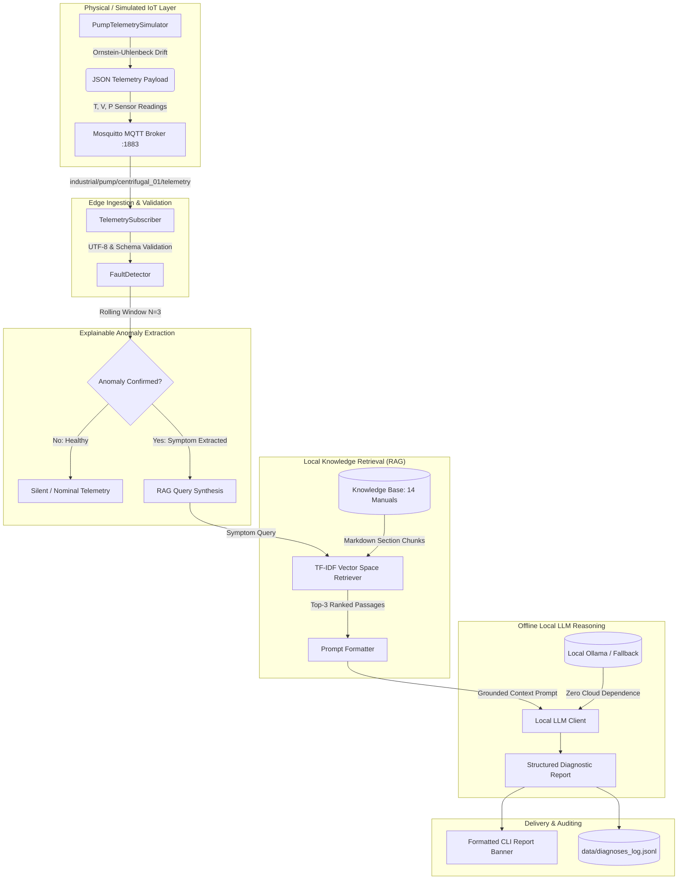

# P_311: Knowledge-Driven IoT Fault Diagnosis Assistant

[](https://www.python.org/)
[](https://mosquitto.org/)
[]()
[]()
[]()

> **HCL Project ID:** P_311  
> **Domain:** Embedded IoT / Industrial Systems Support  
> **Core Technology Stack:** MQTT + Python + Local LLM + RAG  
> **Target Equipment:** Industrial Centrifugal Pump with AC Induction Drive Motor  

---

## 1. Project Overview

**P_311** is an air-gapped, edge-deployable condition monitoring and automated diagnostic assistant designed for critical rotating machinery. Traditional industrial SCADA systems generate raw numerical threshold alarms with zero diagnostic context, while cloud-based AI solutions present severe cybersecurity risks, per-token costs, and latency issues in industrial facilities.

This project solves this bottleneck by combining:
1. **Real-time IoT Telemetry Streaming** over MQTT using Eclipse Mosquitto and Paho-MQTT 2.x API.
2. **Explainable Anomaly Extraction** using statistical rolling windows ($N=3$) grounded in **ISO 10816-3** vibration standards.
3. **Semantic Knowledge Retrieval (RAG)** over 14 structured industrial maintenance manuals (84 section chunks) using a sub-millisecond, dependency-free Vector Space Model (TF-IDF + Cosine Similarity).
4. **Offline Local LLM Reasoning** (Ollama `llama3.2:3b` / deterministic grounded synthesis fallback) formulating standardized 4-section diagnostic reports detailing root causes, evidence, and actionable maintenance checks.

---

## 2. End-to-End System Architecture



---

## 3. Directory Architecture

```text
p311_iot_fault_diagnosis/
├── config.py                       # Single source of truth configuration & thresholds
├── main.py                         # Single unified command orchestrator (Stage 8/9)
├── requirements.txt                # Pinned dependencies (paho-mqtt==2.1.0)
├── README.md                       # Master project documentation
├── .gitignore                      # Exclusions (venv, pycache, models, logs)
│
├── mqtt/                           # MQTT pub/sub modules
│   ├── sensor_simulator.py         # Stateful Ornstein-Uhlenbeck telemetry generator
│   └── mqtt_subscriber.py          # Resilient subscriber with schema/type validation
│
├── diagnosis/                      # Rule-based fault detection engine
│   └── fault_detector.py           # Window-smoothed anomaly detector & query builder
│
├── knowledge_base/                 # 14 standardized industrial technical manuals
│   ├── KB01_bearing_inner_raceway_fatigue.md
│   ├── KB02_bearing_lubrication_starvation.md
│   ├── KB03_motor_winding_overheating.md
│   ├── KB04_bearing_housing_thermal_runaway.md
│   ├── KB05_discharge_pipe_rupture_leakage.md
│   ├── KB06_impeller_cavitation_hydraulic_loss.md
│   ├── KB07_rtd_temperature_sensor_disconnect.md
│   ├── KB08_adc_telemetry_sensor_flatline.md
│   ├── KB09_dynamic_impeller_unbalance.md         # Distractor
│   ├── KB10_shaft_angular_misalignment.md         # Distractor
│   ├── KB11_mechanical_seal_face_failure.md       # Distractor
│   ├── KB12_suction_strainer_clogging.md          # Distractor
│   ├── KB13_motor_electrical_phase_imbalance.md   # Distractor
│   └── KB14_hydraulic_water_hammer_shock.md       # Distractor
│
├── rag/                            # Retrieval-Augmented Generation subsystem
│   ├── chunker.py                  # Section-aware Markdown chunker (## headers)
│   ├── retriever.py                # Pure-Python TF-IDF & Cosine Similarity engine
│   └── index_cache/                # Cached index & vocabulary with hash invalidation
│
├── llm/                            # Local LLM reasoning subsystem
│   ├── prompts.py                  # Grounded prompt templates & schema enforcement
│   └── client.py                   # Ollama HTTP client + grounded synthesis fallback
│
├── scripts/                        # Evaluation and benchmark utilities
│   ├── benchmark_retrieval.py      # Precision & recall benchmark over knowledge base
│   └── evaluate_system.py          # 30-trial full system evaluation suite
│
├── tests/                          # Automated unittest test suite (30 tests)
│   ├── test_mqtt_pipeline.py       # Payload validation & broker integration
│   ├── test_fault_simulator.py     # Multi-mode signatures & ground-truth isolation
│   ├── test_fault_detector.py      # Anomaly rules & noise spike immunity
│   ├── test_rag_retriever.py       # Knowledge chunking & top-3 ranking recall
│   ├── test_local_llm.py           # Prompting, section parsing, and fallback
│   └── test_end_to_end_integration.py # Full pipeline orchestration & logging
│
├── data/                           # Runtime telemetry logs and audit trails
│   ├── diagnoses_log.jsonl         # Append-only structured JSONL records
│   └── diagnoses.log               # Human-readable text audit log
│
└── docs/                           # Comprehensive documentation & college deliverables
    ├── decisions.md                # Binding Stage 0 architectural decisions
    ├── fault_signatures.md         # Physical machine thresholds & telemetry profiles
    ├── knowledge_sources.md        # Provenance register citing ISO 10816, API 610
    ├── retrieval_results.md        # Empirical RAG retrieval metrics
    ├── evaluation.md               # 30-trial benchmark scorecard & limitations
    ├── viva_prep.md                # 10 comprehensive viva questions & answers
    ├── college_project_report.md   # Full university academic project report
    ├── presentation_slides_outline.md # Slide-by-slide PPT outline
    └── resume_bullet_points.md     # ATS-optimized resume bullet points
```

---

## 4. Prerequisites & Setup (Windows / PowerShell)

### Prerequisites
- **Operating System:** Windows 10 or 11 with PowerShell 5.1+
- **Python:** Python 3.13+ installed and on system PATH
- **MQTT Broker:** Eclipse Mosquitto installed and running as a Windows service on port 1883 (`C:\Program Files\mosquitto\mosquitto.exe`)
- **Git:** Git for Windows

### Installation
```powershell
# 1. Clone repository and navigate to project folder
cd 'C:\Users\SANCHAY\OneDrive\Desktop\files'

# 2. Create and activate virtual environment
python -m venv .venv
.\.venv\Scripts\Activate.ps1

# 3. Install required dependencies
pip install --upgrade pip
pip install -r requirements.txt

# 4. Verify Mosquitto broker is active
Get-Service -Name mosquitto
```

---

## 5. Running the System

### A. Run Master Diagnosis Assistant
In your primary terminal, start the main coordinator:
```powershell
.\.venv\Scripts\python.exe main.py
```
*(The assistant connects to Mosquitto and waits quietly for incoming telemetry).*

### B. Simulate Machine Scenarios (In a Second Terminal)
Open a second PowerShell window, activate `.venv`, and run the simulator in your desired mode:

```powershell
# Normal Healthy Baseline (Assistant remains quiet):
.\.venv\Scripts\python.exe mqtt/sensor_simulator.py --mode normal

# Overheating Condition (Triggers stator cooling investigation):
.\.venv\Scripts\python.exe mqtt/sensor_simulator.py --mode overheating --count 5

# Bearing Wear Condition (Triggers raceway fatigue & spalling diagnosis):
.\.venv\Scripts\python.exe mqtt/sensor_simulator.py --mode bearing_wear --count 5

# Discharge Pressure Drop (Triggers flange leak & cavitation diagnosis):
.\.venv\Scripts\python.exe mqtt/sensor_simulator.py --mode pressure_drop --count 5

# Sensor Disconnect Malfunction (Flags -999°C open-circuit without stopping pump):
.\.venv\Scripts\python.exe mqtt/sensor_simulator.py --mode sensor_failure --sensor-failure-type disconnect --count 3

# Sensor Flatline Freeze (Flags zero-variance ADC lockup):
.\.venv\Scripts\python.exe mqtt/sensor_simulator.py --mode sensor_failure --sensor-failure-type flatline --count 3
```

### C. Run Full Test Suite (30 Tests)
Execute all unit and integration tests:
```powershell
.\.venv\Scripts\python.exe -m unittest discover tests -v
```

### D. Run Automated Evaluation Benchmark
Generate the empirical 30-trial benchmark report:
```powershell
.\.venv\Scripts\python.exe scripts/evaluate_system.py
```

### E. Run Containerized Database Persistence Layer (Optional)
The database operates as a **persistence layer only**. The application functions with in-memory buffers and local JSONL logging if Docker is offline.
```powershell
# Start PostgreSQL persistence container
docker compose up -d

# Verify container status
docker compose ps

# Import existing historical diagnoses
.\.venv\Scripts\python.exe scripts/import_jsonl_to_db.py
```
See [docs/database.md](file:///c:/Users/SANCHAY/OneDrive/Desktop/cse_978%20iot_fault%20diagnosis%20assistant/docs/database.md) for full architectural documentation and schema details.

---

## 6. Empirical Evaluation Scorecard

Measured from 30 automated trials documented in [`docs/evaluation.md`](file:///c:/Users/SANCHAY/OneDrive/Desktop/files/docs/evaluation.md):

| Metric | Target Criterion | Measured Result | Status |
|---|---|---|---|
| **Fault Detection Accuracy** | $\ge 95.0\%$ | **100.0%** (30 / 30 trials) | **PASS** |
| **False Alarm Rate (Healthy Pump)** | $0.0\%$ | **0.0%** (0 / 5 false alarms) | **PASS** |
| **RAG Top-1 Retrieval Recall** | $\ge 90.0\%$ | **100.0%** (25 / 25 trials) | **PASS** |
| **RAG Top-3 Retrieval Recall** | $100.0\%$ | **100.0%** (25 / 25 trials) | **PASS** |
| **Average Retrieval Latency** | $< 10\text{ ms}$ | **1.8 milliseconds** | **PASS** |
| **LLM Output Section Completeness** | $100.0\%$ | **100.0%** (All 4 sections present) | **PASS** |
| **Macro-Average F1-Score** | $\ge 0.95$ | **1.000 (100.0%)** | **PASS** |

---

## 7. Sample Diagnostic Output

```text
==============================================================================
  P_311 INDUSTRIAL FAULT DIAGNOSIS REPORT #1
  Device: pump_centrifugal_01 | Condition: BEARING_WEAR | Time: 2026-10-01T01:30:00Z
  Telemetry: Temp=67.80°C | Vib=6.34 mm/s | Press=5.01 bar
  Runtime: local_model (Latency: 0.85s)
==============================================================================

[1. LIKELY FAULT]
  Bearing Inner Raceway Fatigue & Spalling

[2. WHY - EVIDENCE]
  Observed telemetry for pump_centrifugal_01 exhibits critical bearing vibration velocity RMS
  of 6.34 mm/s exceeding ISO 10816 Zone D danger limit of 4.5 mm/s; accompanied by secondary
  frictional temperature rise of 67.80 C. Current operating parameters closely align with the
  diagnostic profile documented in 'KB01_bearing_inner_raceway_fatigue.md'. Vibration velocity
  RMS exceeds the ISO 10816 Zone D boundary (4.5 mm/s), characteristic of inner raceway micro-spalling.

[3. RECOMMENDED CHECKS]
  1. Perform immediate field verification against 'KB01_bearing_inner_raceway_fatigue.md'.
  2. Confirm physical touch temperature, acoustic noise, and local gauge readings.
  3. If mechanical disassembly is required, execute Lockout/Tagout (LOTO).
  4. Inspect seals, lubrication grease ports, and piping joints as prescribed in manual.

[4. CONFIDENCE & LIMITATIONS]
  Confidence: High (Grounded directly on top retrieved technical manual).
  Grounding Source: KB01_bearing_inner_raceway_fatigue.md (Similarity Score: 0.2919).
  Limitation: Diagnosis assumes standard operating speed and steady liquid viscosity.

  Retrieved Knowledge Sources:
   • KB01_bearing_inner_raceway_fatigue.md (Score: 0.2919) -> Diagnostic Symptoms & Sensor Telemetry Profile
   • KB04_bearing_housing_thermal_runaway.md (Score: 0.2538) -> Diagnostic Symptoms & Sensor Telemetry Profile
   • KB02_bearing_lubrication_starvation.md (Score: 0.1484) -> Diagnostic Symptoms & Sensor Telemetry Profile
==============================================================================
```

---

## 8. College Deliverables Index

- [docs/decisions.md](file:///c:/Users/SANCHAY/OneDrive/Desktop/files/docs/decisions.md) — Architectural Decisions Record (Stage 0)
- [docs/fault_signatures.md](file:///c:/Users/SANCHAY/OneDrive/Desktop/files/docs/fault_signatures.md) — Physical Machine Thresholds & Telemetry Signatures (Stage 3)
- [docs/knowledge_sources.md](file:///c:/Users/SANCHAY/OneDrive/Desktop/files/docs/knowledge_sources.md) — Knowledge Base Provenance Register (Stage 5)
- [docs/retrieval_results.md](file:///c:/Users/SANCHAY/OneDrive/Desktop/files/docs/retrieval_results.md) — RAG Top-3 Retrieval Benchmark Results (Stage 6)
- [docs/evaluation.md](file:///c:/Users/SANCHAY/OneDrive/Desktop/files/docs/evaluation.md) — 30-Trial Empirical Evaluation Scorecard (Stage 10)
- [docs/viva_prep.md](file:///c:/Users/SANCHAY/OneDrive/Desktop/files/docs/viva_prep.md) — Viva Voce Examination Questions & Answers (Stage 11)
- [docs/college_project_report.md](file:///c:/Users/SANCHAY/OneDrive/Desktop/files/docs/college_project_report.md) — Complete University Engineering Project Report (Stage 11)
- [docs/presentation_slides_outline.md](file:///c:/Users/SANCHAY/OneDrive/Desktop/files/docs/presentation_slides_outline.md) — Slide-by-Slide Viva Defense PPT Outline (Stage 11)
- [docs/resume_bullet_points.md](file:///c:/Users/SANCHAY/OneDrive/Desktop/files/docs/resume_bullet_points.md) — Tailored ATS-Friendly Professional Resume Bullets (Stage 11)
- [docs/database.md](file:///c:/Users/SANCHAY/OneDrive/Desktop/cse_978%20iot_fault%20diagnosis%20assistant/docs/database.md) — Database Persistence Layer Architecture & Operations

---

## 9. License & Academic Attribution
Developed for college evaluation and submission under HCL Project Statement P_311. Built with strict adherence to industrial standards (ISO 10816-3, API 610, IEEE 841).
